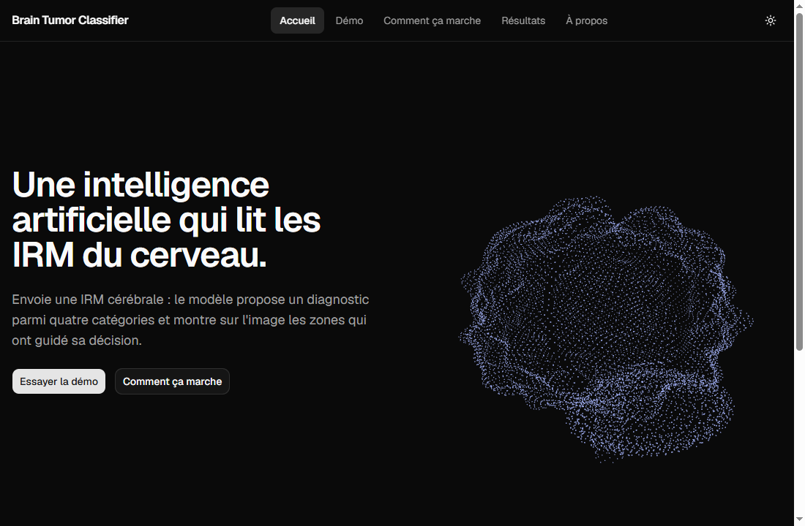
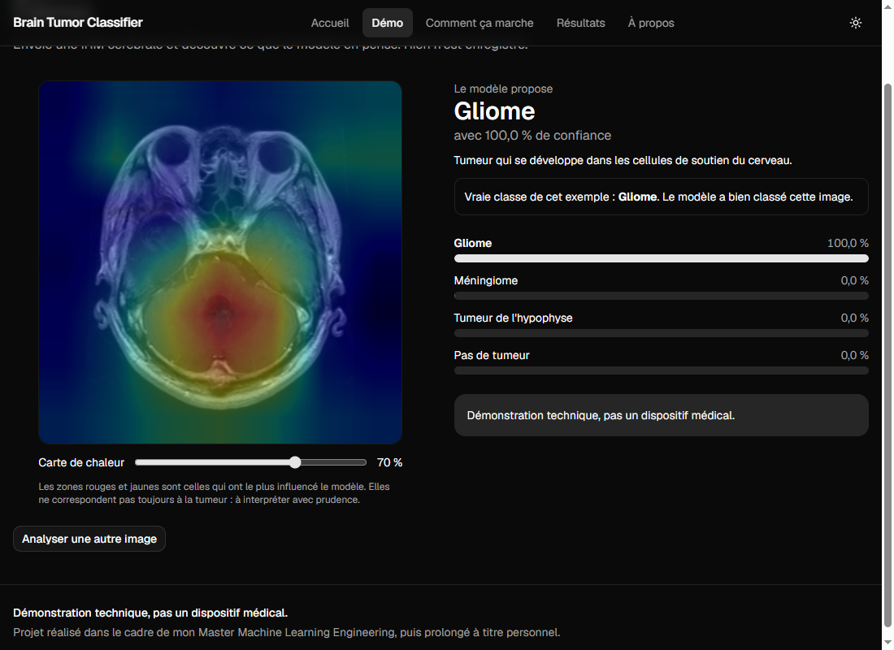
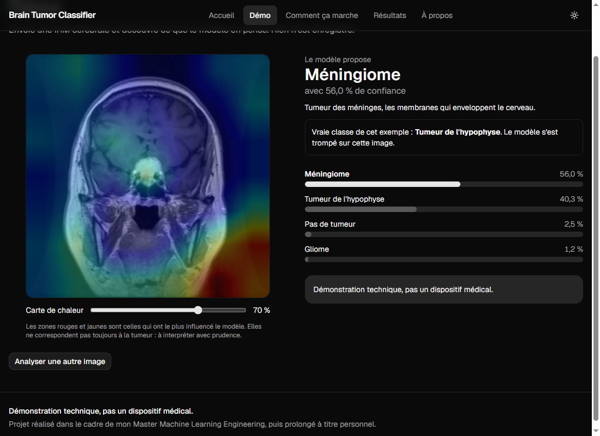
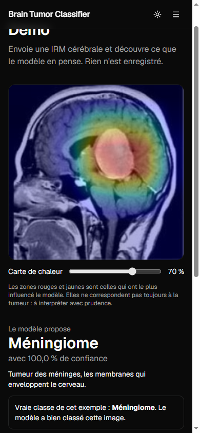
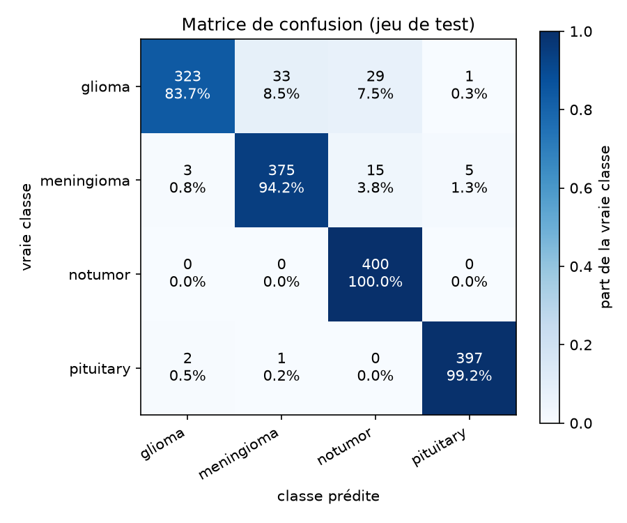
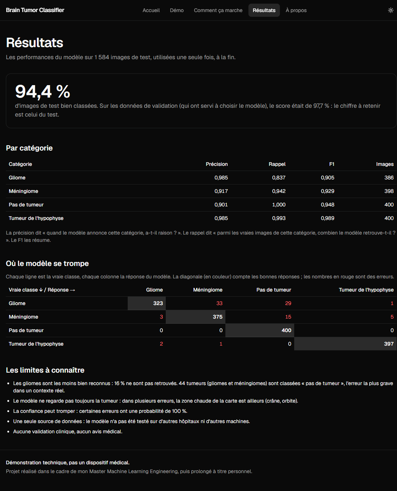
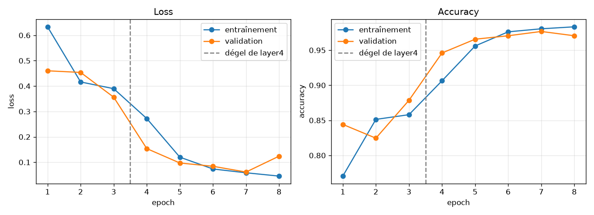
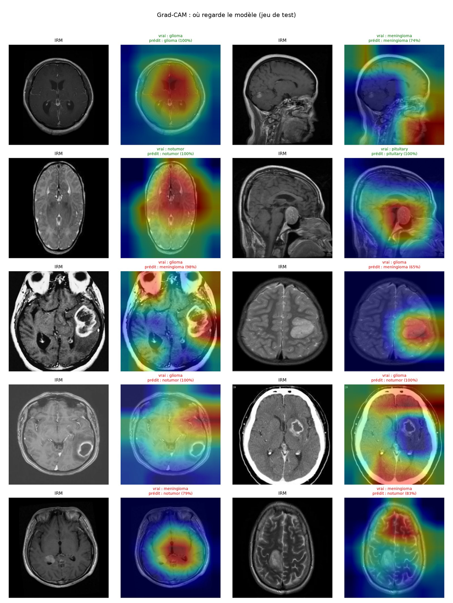
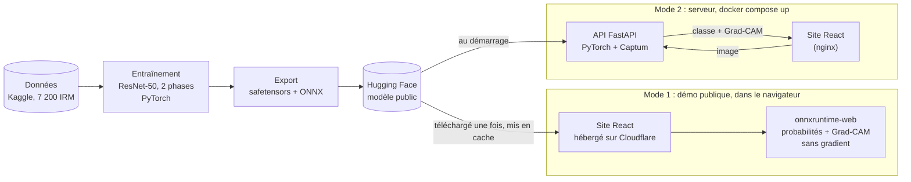

# Brain Tumor Classifier

[](https://github.com/david-b59/deep-learning-projects/actions/workflows/brain-tumor.yml)

**Déposez une IRM du cerveau : un modèle d'intelligence artificielle la classe en 4 catégories (gliome, méningiome, tumeur de l'hypophyse, pas de tumeur) et montre sur l'image la zone qui a guidé sa réponse.**

**[Démo en ligne](https://brain-tumor-classifier.david-b59-ia.workers.dev)**



- **4 catégories avec explication visuelle** : chaque réponse vient avec sa probabilité et une carte de chaleur (Grad-CAM) superposée à l'IRM.
- **Tout tourne dans votre navigateur** : gratuit, et l'IRM ne quitte jamais votre appareil.
- **Un projet complet, testé et automatisé** : entraînement, modèle publié, site web, API, Docker, tests et intégration continue.

> ⚠️ **Démonstration technique, pas un dispositif médical.** Ce projet ne doit jamais servir à un diagnostic ni à une décision de soin. Il n'a fait l'objet d'aucune validation clinique.

Projet réalisé dans le cadre de mon Master Machine Learning Engineering, puis prolongé à titre personnel.

## Sommaire

[Essayer la démo](#essayer-la-démo) · [Résultats](#résultats) · [Limites](#limites) · [Architecture](#architecture) · [Stack](#stack-et-pourquoi) · [Données](#données) · [Lancer le projet](#lancer-le-projet) · [Structure](#structure-du-code) · [Qualité](#qualité) · [Pistes d'amélioration](#pistes-damélioration) · [Historique](#historique-des-évolutions) · [Licences](#licences-et-citations)

## Essayer la démo

1. Ouvrez la [démo en ligne](https://brain-tumor-classifier.david-b59-ia.workers.dev), page **Démo**.
2. Choisissez l'un des 24 exemples (tirés au hasard dans le jeu de test) ou déposez votre propre image JPG ou PNG.
3. Lisez la classe prédite, les probabilités et la carte Grad-CAM (un curseur règle sa transparence).

À la première visite, le navigateur télécharge le modèle (94 Mo) une seule fois, puis le garde en cache : les visites suivantes sont immédiates.



**Un exemple où le modèle se trompe** : la page indique la vraie classe et signale l'erreur. Sur les 24 exemples tirés au hasard, 22 sont bien classés et 2 non.



Le site s'utilise aussi sur téléphone :



## Résultats

Le jeu de test (1 584 images) n'a servi **qu'une seule fois**, à la fin, sur le meilleur modèle.

| Jeu | Accuracy |
|---|---|
| Validation (sert à choisir le modèle) | 97,7 % |
| **Test** (1 584 images jamais vues) | **94,38 %** (89 erreurs) |

L'écart vient du fait que la validation a servi à choisir le modèle : elle est un peu optimiste. **Le chiffre à retenir est celui du test.**

Par classe, sur le test :

| Classe | Précision | Rappel | F1 | Images |
|---|---|---|---|---|
| glioma | 0,985 | **0,837** | 0,905 | 386 |
| meningioma | 0,917 | 0,942 | 0,929 | 398 |
| notumor | 0,901 | 1,000 | 0,948 | 400 |
| pituitary | 0,985 | 0,993 | 0,989 | 400 |

Matrice de confusion (lignes : vraie classe ; colonnes : classe prédite) :



La page « Résultats » du site affiche ces mêmes chiffres :



Courbes d'entraînement (meilleur modèle : epoch 7 sur 8, choisi sur la loss de validation ; l'epoch 8 montre un début de surapprentissage) :



### Lecture des cartes Grad-CAM



Ce qu'on y voit, honnêtement :

- Pour les tumeurs de l'hypophyse, la zone chaude est bien centrée sur la tumeur.
- Pour certains gliomes pris pour « pas de tumeur », le modèle répond avec une confiance de 100 % **sans regarder la tumeur**.
- Un méningiome bien classé s'appuie parfois sur le **fond de l'image**, hors de la tête : une bonne réponse n'est donc pas toujours une bonne raison.
- La carte est grossière (7 x 7 agrandie) : c'est une aide de lecture, pas une preuve.

## Limites

Reprises de la [fiche du modèle](docs/model_card.md) :

- **Les gliomes sont les moins bien reconnus** (rappel 0,837) : 33 sont pris pour des méningiomes et 29 pour « pas de tumeur ». Au total, **44 tumeurs** (gliomes et méningiomes) sont classées « pas de tumeur » : c'est l'erreur la plus grave dans un contexte réel.
- **Confiance trompeuse** : certaines erreurs ont une probabilité de 100 %.
- **Le modèle ne regarde pas toujours la tumeur** (voir les cartes Grad-CAM ci-dessus).
- **Une seule source de données** : des images 2D déjà extraites, sans informations sur les patients, les machines ni les protocoles.
- **Images d'autres sources non testées** : le modèle n'a pas été évalué sur d'autres hôpitaux ni d'autres scanners. Sur vos propres images, les résultats peuvent être peu fiables.
- **Quasi-doublons non détectés** : seules les copies *identiques* ont été retirées. Des images retournées ou recadrées peuvent subsister entre entraînement et test et rendre le score un peu optimiste.
- **Aucune validation clinique**, aucun avis médical.

## Architecture



**Pourquoi deux modes ?** Le projet est d'abord une API (FastAPI) dans un conteneur Docker. Mais héberger un conteneur Docker sur Hugging Face exige un abonnement payant (PRO, 9 $/mois). J'ai choisi une démo **gratuite** : le modèle est exporté au format ONNX et s'exécute directement dans le navigateur. C'est aussi meilleur pour la confidentialité, puisque l'IRM n'est envoyée nulle part. L'API reste disponible, pour une version avec serveur.

**Grad-CAM sans gradient** : la dernière couche du modèle est linéaire, placée après un pooling moyen. Le gradient est donc constant, et la carte Grad-CAM se calcule par une simple multiplication par les poids de cette couche (démonstration dans `ml/src/brain_mri/export_onnx.py`). Le fichier ONNX renvoie directement les probabilités et les cartes. Vérifié contre PyTorch sur 20 images : écart maximal de probabilité 7e-7, de carte 3e-6 (`docs/figures/onnx_check.json`).

## Stack et pourquoi

| Domaine | Outils | Pourquoi |
|---|---|---|
| Modèle | PyTorch, torchvision (ResNet-50) | Transfer learning : un réseau déjà entraîné sur ImageNet, adapté à 4 classes |
| Explication | Captum (Grad-CAM) | Référence pour l'interprétabilité sur PyTorch |
| Suivi d'expériences | MLflow | Garder les courbes et paramètres de chaque entraînement |
| Publication | safetensors, Hugging Face Hub | Poids sans risque d'exécution de code, modèle public |
| Navigateur | ONNX, onnxruntime-web | Exécuter le modèle côté client, gratuit et confidentiel |
| API | FastAPI, Pydantic, Uvicorn | Validation des entrées, documentation automatique |
| Site | React, TypeScript, Vite, Tailwind CSS, shadcn/ui, Three.js | Interface moderne, clair et sombre, accessible |
| Déploiement | Docker, nginx, Cloudflare Workers | Lancement en une commande ; hébergement statique gratuit |
| Qualité | pytest, Vitest, ruff, oxlint, GitHub Actions, Lighthouse | Tests, style et intégration continue |
| Outils Python | uv | Environnements reproductibles (`uv.lock`) |

## Données

- **Jeu** : *Brain Tumor MRI Dataset* de Masoud Nickparvar ([Kaggle](https://www.kaggle.com/datasets/masoudnickparvar/brain-tumor-mri-dataset)), licence CC BY 4.0.
- 7 200 images, 4 classes (glioma, meningioma, notumor, pituitary), dossiers `Training` et `Testing`.
- **187 copies identiques retirées** (empreinte SHA-256) pour qu'une même image ne se retrouve pas des deux côtés d'un découpage.
- Découpage : entraînement **4 614**, validation **815** (part stratifiée de `Training`), test **1 584** (dossier `Testing`, utilisé une seule fois).

Les données et les poids ne sont pas dans git : un script de téléchargement et un modèle publié à part.

## Lancer le projet

### Avec Docker (API + site)

Prérequis : Docker. Depuis le dossier `brain-tumor-classifier/` :

```bash
docker compose up --build
```

Puis ouvrir http://localhost:8080. L'API écoute sur le port 8000. Au démarrage, elle télécharge le modèle depuis Hugging Face (dépôt `david-b59/brain-tumor-classifier`). Dans ce mode, le site envoie l'image à l'API au lieu d'utiliser le navigateur.

### Développer le site

Prérequis : Node.js. Depuis `brain-tumor-classifier/frontend/` :

```bash
npm install
npm run dev
```

Sans `VITE_API_URL`, le site fonctionne en mode navigateur : il télécharge le modèle ONNX depuis Hugging Face (ou depuis `VITE_MODEL_URL` si vous la définissez dans `.env.local`). Autres commandes : `npm run build`, `npm run lint`, `npm test`.

### Lancer l'API seule

Depuis `brain-tumor-classifier/api/` :

```bash
uv sync
uv run uvicorn app.main:app --port 8000
```

Routes : `GET /health`, `GET /metrics-summary`, `POST /predict` (champ `file`, JPG ou PNG, 5 Mo maximum). Documentation interactive sur http://localhost:8000/docs. Réglages par variables d'environnement (`MODEL_DIR`, `MODEL_REPO_ID`, `CORS_ORIGIN`) : voir `.env.example`.

### Reproduire l'entraînement

Prérequis : Python 3.12 et [uv](https://docs.astral.sh/uv/). Copiez `.env.example` en `.env` et renseignez `KAGGLE_USERNAME` et `KAGGLE_API_TOKEN`. Puis, depuis `brain-tumor-classifier/ml/` :

```bash
uv sync --extra train                          # installe aussi les outils d'entraînement
uv run python scripts/download_data.py         # télécharge les données (Kaggle)
uv run python scripts/check_duplicates.py      # repère les images en double
uv run python -m brain_mri.train               # entraîne (2 phases)
uv run python -m brain_mri.evaluate            # évalue sur le jeu de test (une seule fois)
uv run python -m brain_mri.gradcam             # galerie Grad-CAM
uv run python -m brain_mri.export_onnx --verify  # export ONNX + vérification
uv run python -m brain_mri.publish             # export du dossier de publication
```

`uv run python -m brain_mri.train --max-batches 2` permet un essai rapide. Mon entraînement complet a duré environ 2 h 44 sur un processeur sans carte graphique. La publication sur Hugging Face (`brain_mri.publish --push`) demande un jeton `HF_TOKEN` avec droit d'écriture. Les hyperparamètres sont dans `ml/configs/train.yaml`.

## Structure du code

```
brain-tumor-classifier/
├── ml/                      Entraînement et évaluation (package brain_mri)
│   ├── configs/train.yaml   Hyperparamètres
│   ├── scripts/             Téléchargement, doublons, contrôles
│   ├── notebooks/           Exploration des données, Grad-CAM pas à pas
│   ├── src/brain_mri/       config, duplicates, data, transforms, model, train, evaluate,
│   │                        gradcam, explain, predict, publish, export_onnx,
│   │                        frontend_data, examples
│   └── tests/               85 tests pytest
├── api/                     API FastAPI (app/main.py, config, schémas) + Dockerfile
├── frontend/                Site React + TypeScript
│   ├── src/pages/           Accueil, Démo, Résultats, Comment ça marche, À propos
│   ├── src/lib/             Inférence navigateur (inference, model, classify)
│   ├── public/examples/     24 images d'exemple du jeu de test (CC BY 4.0)
│   └── wrangler.jsonc       Déploiement Cloudflare
├── docs/                    Fiche du modèle, figures et résultats chiffrés
├── docker-compose.yml       API + site en une commande
└── .env.example             Variables d'environnement (sans valeur secrète)
```

## Qualité

- **Tests** : 85 tests pour `ml/` (pytest), 19 pour `api/` (pytest), 23 pour le site (Vitest, fonctions d'inférence du navigateur).
- **Intégration continue** (GitHub Actions) : 4 jobs à chaque modification du dossier : `ml` (ruff + pytest), `api` (ruff + pytest), `front` (lint, tests, build), `docker` (construction des images et validation du compose).
- **Lighthouse** :

| Mesure | Performance | Accessibilité | Bonnes pratiques | SEO |
|---|---|---|---|---|
| Ordinateur (accueil) | 98 | 100 | 100 | 100 |
| Mobile simulé (réseau et processeur ralentis), selon la page | 75 à 91 | 100 | 96 à 100 | 100 |

Le mode mobile de Lighthouse est très sévère. Les scores de performance varient d'environ 8 points d'un passage à l'autre. Le 96 en bonnes pratiques vient d'une erreur de réseau liée à la façon dont le test servait le site, pas d'un défaut du site.

## Pistes d'amélioration

1. **Mesurer la généralisation** sur 20 à 30 IRM externes à étiquette fiable.
2. **Entraîner sur plusieurs sources** avec une augmentation plus forte, pour mieux résister aux changements de machine et de protocole.
3. **Ajouter une classe « autre / pas une IRM »** ou un seuil de confiance, pour que le modèle sache dire qu'il ne sait pas.
4. **Autres pathologies** : ce serait un nouveau modèle sur de nouvelles données annotées, donc un projet à part.
5. **Corriger les faiblesses connues** : rappel des gliomes (0,837), quasi-doublons entre entraînement et test.
6. **Quantification int8** : testée puis écartée (24 Mo au lieu de 94 Mo, mais −1,07 point d'accuracy, 94,38 % → 93,31 %). À reprendre avec une autre méthode.

## Historique des évolutions

| Date | Évolution | Pourquoi et gain |
|---|---|---|
| 2026-11-03 | Copies identiques retirées avant tout découpage | 187 doublons écartés : le test ne contient aucune image vue à l'entraînement |
| 2026-11-03 | BatchNorm gelé remis en mode évaluation, optimiseur sur les seuls paramètres entraînables, sélection du modèle sur la validation | Corrections par rapport à mon cours, pour un entraînement correct |
| 2026-11-05 | Exemples de la démo tirés au hasard au lieu de 4 images choisies | Les 4 images bien classées étaient trop flatteuses ; la démo montre maintenant 22 réussites et 2 erreurs sur 24 |
| 2026-11-05 | Module de prédiction léger, torch CPU seul | Environnement de l'API réduit de 1,2 Go à 778 Mo, prédictions identiques |
| 2026-11-05 | Motion et React Three Fiber remplacés par du CSS et Three.js direct | Code 3D de 920 Ko à 531 Ko, paquet principal de 460 à 330 Ko ; Lighthouse mesuré avant et après |
| 2026-11-05 | API remplacée par l'inférence dans le navigateur (ONNX) pour la démo publique | Héberger l'API Docker sur Hugging Face demande un abonnement payant ; démo gratuite et confidentielle. L'API reste disponible |
| 2026-11-05 | Correction du redimensionnement dans le navigateur (antialiasing comme PyTorch) | Écart de probabilité avec PyTorch ramené de 7,2 à 0,15 point, mêmes classes sur les 6 images de contrôle |
| 2026-11-05 | Contournement d'un blocage CORS Hugging Face / workers.dev (téléchargement du modèle sans en-tête `Referer`) | Découvert en testant le site réellement publié ; le téléchargement fonctionne depuis l'adresse publique |

## Licences et citations

- **Code et poids de ce projet** : licence [MIT](../LICENSE).
- **Données** : Masoud Nickparvar, *Brain Tumor MRI Dataset*, Kaggle, licence CC BY 4.0. Les 24 images d'exemple du site en sont extraites.
- **Modèle de départ** : ResNet-50 de torchvision, pré-entraîné sur ImageNet (`IMAGENET1K_V1`).
- **Modèle publié** : https://huggingface.co/david-b59/brain-tumor-classifier
